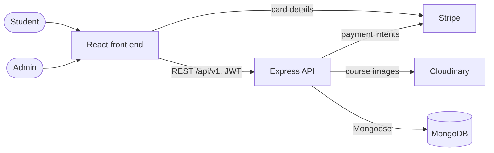

# ELearn: High-Level Design

A full-stack course-selling platform: students browse and buy courses with Stripe, admins create and manage courses with Cloudinary-hosted images. Built on the MERN stack. Live at [e-learnn.vercel.app](https://e-learnn.vercel.app). For code-level detail see the [Low-Level Design](lld.md).

## 1. Context

## 2. Components

| Area | Responsibility |
|---|---|
| Student pages | Home, courses, buy, purchases, login, sign-up |
| Admin pages | Admin login / sign-up, create course, update course, our courses |
| `/api/v1/user` | Student auth and purchases |
| `/api/v1/admin` | Admin auth |
| `/api/v1/course` | Course CRUD (admin), list and details (public), buy (student) |
| `/api/v1/order` | Records a successful payment and grants access |

## 3. Tech

| Layer | Choice |
|---|---|
| Front end | React (Vite), React Router, axios, Stripe Elements |
| Back end | Node.js, Express, Mongoose, zod validation |
| Auth | bcrypt passwords, JWT (1 day) in an httpOnly cookie, separate user and admin middleware |
| Payments | Stripe Payment Intents (USD) |
| Media | Cloudinary |
