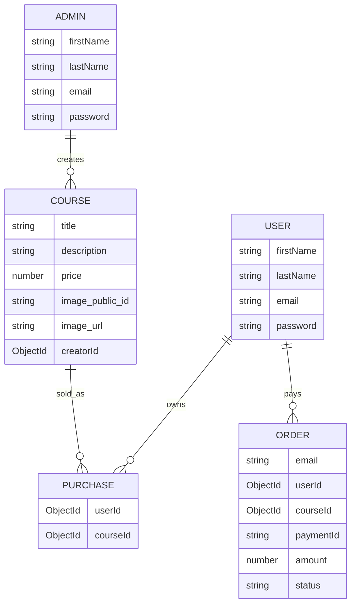
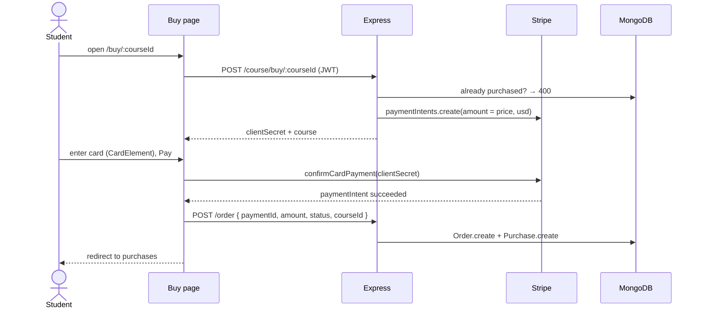

# ELearn: Low-Level Design

For the big picture see the [High-Level Design](hld.md).

## 1. Models

## 2. API (`/api/v1`)

| Method | Route | Guard | Behavior |
|---|---|---|---|
| POST | `/user/signup`, `/user/login` | | zod validation, bcrypt, JWT cookie |
| GET | `/user/logout` | | Clears the cookie |
| GET | `/user/purchases` | user | Purchased courses |
| POST | `/admin/signup`, `/admin/login`, GET `/admin/logout` | | Same for admins |
| POST | `/course/create` | admin | Uploads image to Cloudinary, saves course with `creatorId` |
| PUT | `/course/update/:courseId` | admin | Only the creator's courses |
| DELETE | `/course/delete/:courseId` | admin | Only the creator's courses |
| GET | `/course/courses`, `/course/:courseId` | | Public catalog and details |
| POST | `/course/buy/:courseId` | user | Rejects repeat purchases; creates a Stripe Payment Intent for the price |
| POST | `/order` | user | Saves the order and creates the purchase |

## 3. Purchase flow

## 4. Configuration

| Variable | Purpose |
|---|---|
| `MONGO_URI` | Database |
| `JWT_USER_PASSWORD`, `JWT_ADMIN_PASSWORD` | Separate signing secrets for students and admins |
| `cloud_name`, `api_key`, `api_secret` | Cloudinary |
| `STRIPE_SECRET_KEY` | Read from `backend/config.js` (empty in the repo); better moved to an environment variable. The front end uses a Stripe publishable test key |
| `FRONTEND_URL`, `PORT` | CORS origin and server port |
